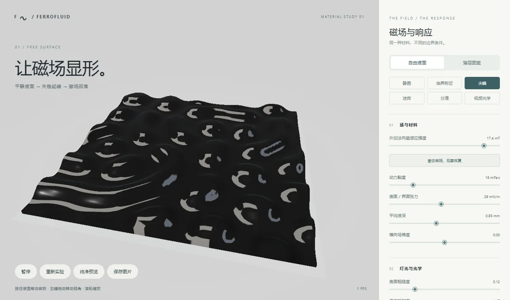
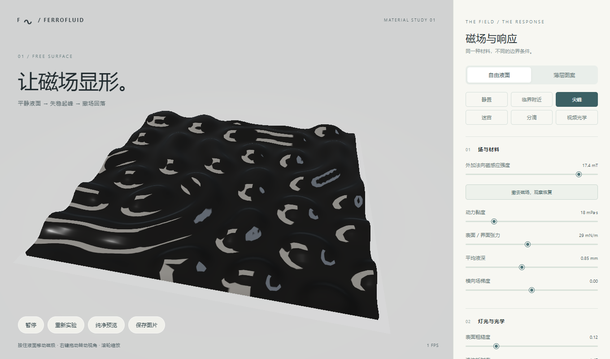
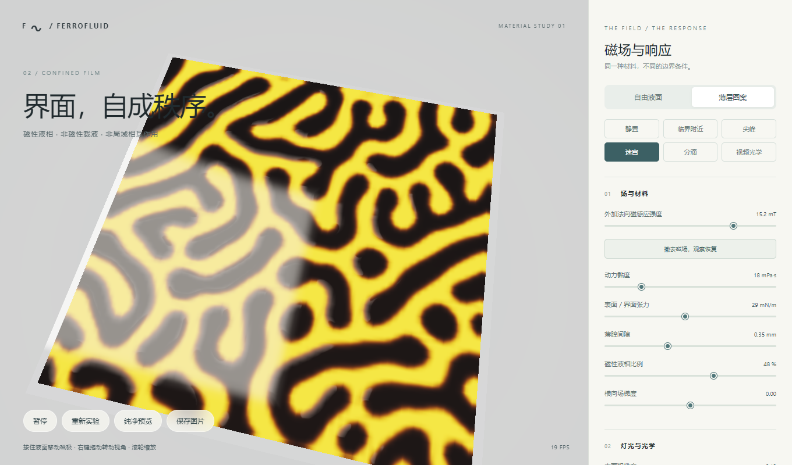

# Ferrofluid Lab 磁流体实验室

在浏览器里调节磁场和流体参数，观察自由表面与受限薄层的形态差异。源码保留原实验的 FFT、物理步进和 WebGL 渲染。

## 实际界面巡览



上图由两张本次实际运行画面的截屏轮换组成，不是连续操作录像。

| 初始实验场景 | 切换后的薄层场景 |
| --- | --- |
|  |  |

## 可以做什么

- 在两种场景间切换
- 调节场强、黏度与质量参数
- 暂停、恢复及观察形态演变

## 本地运行

```sh
python -m http.server 8000 --bind 127.0.0.1
```

在浏览器打开 `http://127.0.0.1:8000/`。只监听本机；不执行部署。

## 实测与范围

打开画布并切换到薄层模式；浏览器实测，非材料测量。

这是降阶模型，不是全三维磁流体求解器。浏览器需支持 WebGL2；音频驱动需用户授权。

[手机宽度实机截屏（390 px）](showcase/03-mobile.png) · [授权范围](LICENSE) · [来源与署名](NOTICE.md)
